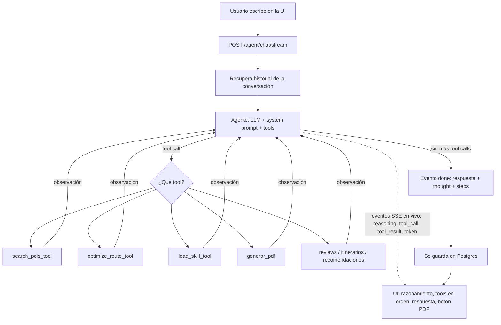

# Guía de exposición — Trabajo Integrador "Agente de IA con LangChain"

Proyecto: **Ando — Asistente turístico de Mendoza** (`ando-chatbot-agent`)

Esta guía recorre la consigna punto por punto y, para cada uno, explica **qué hay en el proyecto, dónde está y cómo defenderlo**. Al principio está el semáforo de cumplimiento, porque hay requisitos obligatorios que hoy el código **no cumple tal como los pide la consigna**.

---

## 0. Semáforo rápido (después de la migración a `create_agent`, sin commitear todavía)

| Req. | Qué pide | Estado | Dónde está / qué falta |
|---|---|---|---|
| 2 | Tarea de varios pasos + resultado tangible + dominio acotado | ✅ | Plan de viaje por días → ruta optimizada → **PDF descargable** |
| 3.1 | Agente con **`create_agent`**, sin Deep Agents | ✅ | `agent/agent.py`: `create_agent(model, tools, system_prompt, middleware, checkpointer)` (LangChain 1.x) |
| 3.2 | ≥3 tools necesarias, 1 propia, 1 externa, errores sin romper el flujo | ✅ | 8 tools propias. Las validaciones devuelven `{"error": ...}` y cualquier excepción la atrapa el middleware propio `tool_errors_as_messages` |
| 3.3 | Memoria con **checkpointer** | ✅ | `InMemorySaver` de LangGraph, `thread_id = conversation_id` |
| 3.4 | UI web que renderiza markdown | ✅ | Next.js + `streamdown` (`frontend/components/chat/markdown.tsx`) |
| 3.5 | Ver tools (args + resultado, en orden) y razonamiento, **en streaming** | ✅ | `POST /agent/chat/stream` (Server-Sent Events) + `AndoTouristAgent.stream()`. La UI pinta cada evento al llegar |
| 3.6 | RAG o Skills usadas en el flujo principal | ✅ | Skills bajo demanda: `skills/pdf-itinerario/SKILL.md` + `load_skill_tool` |
| 3.7 | Middleware de LangChain mínimo y justificado | ✅ | Ningún middleware prearmado. Hay 2 propios (`agent/middleware.py`). El `CORSMiddleware` es de FastAPI |
| 4 | Modelo con tool calling, manejo de 429, idealmente razonamiento | ✅ | Claude Haiku 5.5 con *adaptive thinking* (o gpt-oss-120b en Groq, que también expone razonamiento); `max_retries=6`; 429/413 → mensaje amigable |
| 6.1 | README con instalación, `.env.example`, requirements | ✅ | `README.md` en la raíz, `.env.example` sin claves y `requirements.txt` actualizado |

> **Importante:** la consigna dice que *"un requisito obligatorio de la sección 3 que no esté presente deja su criterio en «No logrado»"*, y que se evalúa el repo **en el último commit anterior a la exposición**. Hay que **commitear y pushear** estos cambios antes de exponer. Ya no queda ningún obligatorio pendiente.

---

## 1. El caso de uso (sección 2 de la consigna)

**Dominio:** turismo en Mendoza. El agente es el asistente de la app *Ando*, que tiene una base de POIs (bodegas, restaurantes, aventura, museos…) con precios, horarios, coordenadas y reseñas.

**Usuario objetivo:** un turista que está planificando su viaje a Mendoza (logueado o no en la app) y quiere armar qué visitar cada día.

**Ejemplo de tarea de varios pasos (la de la demo):**

> "Armame un plan de 2 días: uno en Maipú con bodegas y otro en Luján de Cuyo con algo de gastronomía, presupuesto máximo 30.000 pesos. Después pasámelo a PDF."

Pasos que hace el agente:
1. `search_pois_tool` (Maipú, bodegas, max_price) → candidatos reales.
2. `search_pois_tool` (Luján de Cuyo, gastronomía) → candidatos.
3. Elige 3–4 lugares por día, descartando los cerrados o fuera de presupuesto.
4. `optimize_route_tool` por cada día con 3+ lugares → orden, horas de llegada, avisos de horario.
5. Presenta el plan en markdown.
6. (Turno siguiente, **usa memoria**) "pasalo a PDF" → `load_skill_tool("pdf-itinerario")` → `generar_pdf` con el plan del turno anterior.
7. La UI muestra el botón **Descargar PDF**.

**Por qué cumple las 3 condiciones:**
- *Varios pasos:* no se puede resolver con una llamada: hay que buscar, filtrar, optimizar ruta (un problema de ruteo con OR-Tools) y generar un archivo.
- *Resultado tangible:* un **PDF** del itinerario (plantilla propia con portada, días numerados, zona, descripción y precio) + un plan ordenado con horarios.
- *Acotado:* sólo turismo en Mendoza; el prompt tiene un bloque `<alcance>` que rechaza temas ajenos.

---

## 2. Arquitectura general

```
┌────────────────────┐ POST /agent/chat/stream┌──────────────────────────────────────┐
│ Frontend Next.js   │ ────────────────────▶ │ FastAPI (recommendationService)       │
│ chat-component.tsx │ ◀── eventos SSE ───── │ api/routes_agent.py                   │
│ - Markdown         │ reasoning, tool_call, │  1. busca/crea conversación (Postgres)│
│ - Razonamiento     │ tool_result, token,   │  2. reconstruye historial             │
│ - Tools invocadas  │ done                  │  3. AndoTouristAgent.stream()         │
│ - Botón PDF        │   GET /agent/pdfs/id  │  4. guarda mensaje + razonamiento     │
└────────────────────┘ ────────────────────▶ └──────────────┬───────────────────────┘
                                                             │
                     ┌───────────────────────────────────────▼──────────────────┐
                     │ AndoTouristAgent (agent/agent.py)                         │
                     │  LLM (llm_factory) + System prompt (prompts.py) + Tools    │
                     │  create_agent + checkpointer + middleware propio           │
                     │  loop: LLM decide → tool → observación → LLM … → respuesta │
                     └───┬──────────┬──────────┬──────────┬──────────┬───────────┘
                         │          │          │          │          │
                 search_pois  optimize_route  generar_pdf  load_skill  reviews / itinerarios /
                  (Postgres)   (OR-Tools)     (fpdf2→disco) (SKILL.md)  recomendaciones (Postgres)
```

### Diagrama del flujo del agente (para la presentación)



Estructura de carpetas relevante:

```
recommendationService/app/
├── agent/
│   ├── agent.py            ← construcción y ejecución del agente
│   ├── prompts.py          ← system prompt (alcance, veracidad, uso de tools, estilo)
│   ├── memory/chat_history.py ← convierte historial a mensajes LangChain
│   ├── skills/             ← mecanismo de conocimiento propio (skills)
│   │   └── pdf-itinerario/SKILL.md
│   └── tools/              ← las 8 tools
├── api/routes_agent.py     ← endpoints del chat, historial y descarga de PDF
├── core/llm_factory.py     ← elige proveedor (groq / openai / anthropic)
├── core/config.py          ← variables de entorno y límites
└── services/               ← lógica de negocio (optimizador de rutas, recomendadores, historial)
frontend/components/chat/chat-component.tsx ← UI del chat
```

---

## 3. Requisito 3.1 — Agente base

**Qué hay** (`recommendationService/app/agent/agent.py`):

```python
CHECKPOINTER = InMemorySaver()          # uno solo para todo el proceso

self.graph = create_agent(
    model=self.llm,
    tools=self.tools,
    system_prompt=build_system_prompt(user_id),
    middleware=[trim_history, tool_errors_as_messages],
    checkpointer=CHECKPOINTER,
)
result = self.graph.invoke(
    {"messages": [HumanMessage(message)]},
    config={"configurable": {"thread_id": thread_id}, "recursion_limit": 2 * max_iterations + 1},
)
```

Cómo explicarlo:
- `create_agent` arma un **grafo de LangGraph** con dos nodos: `model` y `tools`. El modelo recibe el system prompt y los mensajes. Si responde con *tool calls*, el grafo pasa al nodo `tools`, que las ejecuta y agrega un `ToolMessage` por cada una, y vuelve al modelo. Termina cuando el modelo responde sin pedir tools (loop ReAct).
- `recursion_limit = 2 × AGENT_MAX_ITERATIONS + 1`: cada vuelta modelo → tools son 2 pasos del grafo. Con el default (10) son como máximo 10 llamadas al modelo. Evita loops infinitos y acota tokens. Si se supera, la API responde "La consulta necesitó demasiados pasos" (`GraphRecursionError`).
- El grafo se crea **por request**, porque las tools dependen de si hay sesión (las personales llevan el `user_id`). El checkpointer es global, así que la memoria persiste entre requests.
- Para mostrar las tools en la UI, `_steps()` recorre los mensajes del turno: cada `AIMessage.tool_calls` se empareja por `tool_call_id` con su `ToolMessage`.
- El razonamiento sale de `message.content_blocks` con tipo `"reasoning"`. Es el **formato estándar de LangChain 1.x**, que normaliza el `thinking` de Claude y el reasoning de gpt-oss, así que funciona con cualquier proveedor.
- No se usa Deep Agents. ✅

**Historia (por si preguntan):** antes usaban `AgentExecutor` + `create_tool_calling_agent` (LangChain 0.3). Migraron a `create_agent` porque es lo que pide la consigna y la API actual de LangChain 1.x. Además trae checkpointer y middleware integrados.

---

## 4. Requisito 3.2 — Tools

Todas son **propias** (escritas por el grupo con `@tool` de LangChain) y casi todas **interactúan con algo externo** (PostgreSQL, sistema de archivos, OR-Tools).

| Tool | Qué hace | Entradas | Salida | Externo |
|---|---|---|---|---|
| `search_pois_tool` | Busca POIs aprobados en la BD, con filtros | `query`, `category`, `department`, `max_price`, `limit` | lista de lugares con id, descripción (recortada a 200 chars), precio, puntuación, duración, **horarios** | PostgreSQL |
| `optimize_route_tool` | Ordena las paradas de UN día minimizando traslados y calcula horas de llegada; avisa si un lugar queda fuera de horario | `poi_ids` (2–12), `fecha?`, `hora_inicio`, `modo_viaje` | paradas ordenadas, llegada, traslados, distancia/tiempo total, `aviso_horario` | PostgreSQL + **OR-Tools** (solver determinista, sin LLM) |
| `generar_pdf` | Genera el PDF del itinerario con plantilla propia (fpdf2, fuentes DejaVu para tildes/ñ) | `name`, `title`, `subtitle?`, `dias[] → lugares[]` (schema Pydantic `PdfInput`) | `{file_id, filename}` | **Sistema de archivos** (`generated_pdfs/`) |
| `load_skill_tool` | Carga el cuerpo de una skill | `name` | texto markdown de la skill | Sistema de archivos |
| `get_poi_reviews_summary_tool` | Resumen de reseñas de un lugar | `poi` (UUID o nombre) | puntuación y reseñas | PostgreSQL |
| `get_user_itinerary_tool`* | Lista o detalla los itinerarios guardados del usuario | `itinerary_id?` | itinerarios / paradas | PostgreSQL |
| `get_personalized_recommendations_tool`* | Recomendaciones según el historial del usuario (scoring ponderado: ratings, categorías, favoritos, recencia, precio) | `limit` | POIs con score | PostgreSQL |
| `get_similar_users_recommendations_tool`* | Filtrado colaborativo (usuarios parecidos) | `limit` | POIs | PostgreSQL + scikit-learn |

\* Sólo existen si hay sesión. Se construyen con una *closure* (`build_*_tool(user_id)`) para que **el `user_id` lo fije el servidor y nunca el LLM** (seguridad: el modelo no puede pedir datos de otro usuario). Ver `agent/tools/__init__.py`.

**Sesión en la demo:** no hay login real. En el pie de la barra lateral hay un selector de cuenta: los turistas de la base, que salen de `GET /agent/users` ordenados por historial, más **"Sin sesión (invitado)"**. La UI manda ese `user_id` (o `null`).
- **Sin sesión:** el agente no recibe las tools personales y la conversación no se guarda en Postgres. La memoria del chat sigue funcionando por el checkpointer.
- **Para la demo:** usar **Sol Falabella** o **Martina Luconi**, que tienen historial suficiente para recomendaciones personalizadas (≥5 valoraciones y un itinerario finalizado). Cambiar a "Sin sesión" muestra que esas tools desaparecen.

**Bug corregido en el prompt:** antes el prompt traía las dos reglas a la vez: "si inició sesión usá X / si no, decile que inicie sesión". Con la sesión iniciada, gpt-oss llamó a `get_personalized_recommendations_tool`, recibió las recomendaciones y después igual respondió "necesito que inicies sesión": aplicó la regla equivocada. Ahora `session_context()` mete en `<contexto_de_sesion>` **solo la regla de la sesión actual**. Lección para la defensa: instrucciones condicionales que no aplican confunden al modelo; mejor armar el prompt según el contexto.

### Cuáles son *necesarias* para el caso principal (para defender "todas necesarias")
- **`search_pois_tool`**: sin ella el agente inventaría lugares; el prompt (`<veracidad>`) le prohíbe mencionar lugares que no vengan de una tool.
- **`optimize_route_tool`**: el LLM no puede calcular bien un orden óptimo con distancias, duraciones y horarios; es un problema de optimización combinatoria (TSP con ventanas horarias) → se delega a OR-Tools.
- **`generar_pdf`**: es el resultado tangible.
- **`load_skill_tool`**: trae las reglas de cómo armar el PDF (ver 3.6).
- Reviews / itinerarios / recomendaciones: amplían el caso (planificar a partir de un itinerario guardado, elegir según opiniones). **Ojo:** la consigna dice que si una tool se puede eliminar sin afectar el caso principal "no cuenta" y el criterio "parcial" incluye "alguna tool sobra". Prepárense para justificar cada una con un ejemplo de uso en la demo (p. ej. "pasame a PDF mi itinerario guardado" usa `get_user_itinerary_tool`).

### Buenas descripciones y argumentos
- Cada tool tiene **docstring** que el LLM ve como descripción, con cada parámetro explicado y ejemplos.
- `generar_pdf` usa un **schema Pydantic** (`args_schema=PdfInput`) con `Field(description=...)` anidado (`Dia` → `Lugar`), lo que le da al modelo un JSON Schema estricto.
- El system prompt además tiene un bloque `<tools>` que dice **cuándo** usar cada una (p. ej. "optimize_route sólo con 3+ lugares, una vez por día").

### Manejo de errores
- `optimize_route_tool` valida todo y **devuelve** `{"error": "..."}` en vez de lanzar (cantidad de ids, UUID válidos, modo de viaje, formato de hora, `ValueError` del solver). El LLM lee el error y se corrige.
- `ids.is_uuid` rechaza ids inválidos antes de que Postgres tire `DataError`.
- `load_skill_tool` devuelve un mensaje con las skills disponibles si el nombre no existe.
- **Excepciones inesperadas** (BD caída, error al escribir el PDF): las atrapa el middleware propio **`tool_errors_as_messages`** (`agent/middleware.py`). Por defecto, el `ToolNode` de LangGraph solo atrapa errores de validación de argumentos y re-lanza el resto, lo que cortaba el turno con un HTTP 500. El middleware devuelve un `ToolMessage` con `status="error"` y el texto "la tool X falló… no inventes el resultado". El modelo lo lee y decide: reintenta, cambia de estrategia o le avisa al usuario. Hay un test que lo demuestra (`test_tool_exception_does_not_break_the_flow`).
- **Resultado vacío:** si `search_pois_tool` no encuentra nada devuelve `[]`, que llegaba como `ToolMessage` sin contenido, y Groq rechaza esa petición con un 400. El mismo middleware lo reemplaza por `"Sin resultados."` y el modelo propone ampliar la búsqueda, como pide el bloque `<veracidad>` del prompt.
- A nivel API, cualquier otra excepción se loguea y al cliente se le devuelve un mensaje genérico; 429/413 del proveedor → "Esperá un minuto…".

---

## 5. Requisito 3.3 — Memoria de corto plazo

**Cómo funciona:**
1. **Checkpointer `InMemorySaver`** (LangGraph), pasado a `create_agent`. Después de cada paso del grafo guarda el **estado completo** de la conversación: mensajes del usuario, respuestas, tool calls y resultados de las tools.
2. La clave es el **`thread_id`**, que es el `conversation_id` de la BD. En cada request solo se manda el mensaje nuevo; el checkpointer agrega los anteriores de ese hilo. Distintas conversaciones no se mezclan.
3. **Recorte para el contexto:** el estado crece en cada turno. El middleware propio `trim_history` le manda al modelo solo los últimos `AGENT_HISTORY_TURNS` (5) turnos. Siempre corta al inicio de un mensaje del usuario, para no separar una tool call de su resultado. El estado guardado no se toca.
4. **Persistencia aparte en Postgres** (`conversaciones_ia` / `mensajes_ia`, `services/chat_history_service.py`): guarda el texto, el razonamiento y los steps para que la UI liste y reabra conversaciones viejas.
5. **Siembra:** `InMemorySaver` vive en la RAM del proceso. Si el servidor se reinicia y el usuario reabre una conversación vieja, el checkpointer no conoce ese hilo. En ese caso `agent.run` lo siembra con el texto guardado en la BD (`memory/chat_history.py`, últimos 10 mensajes). Si el hilo ya existe, no se siembra, para no duplicar.

**Qué se gana frente al historial manual de antes:** antes solo volvía al modelo el **texto** de cada respuesta. Ahora vuelven también las tool calls y sus resultados. Ejemplo real probado: turno 1 "Dame 3 bodegas en Maipú y ordená la ruta", turno 2 "¿Qué opinan del primero?". En el turno 2 el agente llamó a `get_poi_reviews_summary_tool` con el **UUID** del lugar que había devuelto `search_pois_tool` en el turno 1. Con texto solo, tendría que buscarlo de nuevo por nombre.

**Por qué `InMemorySaver` y no `PostgresSaver`:** es memoria **de corto plazo**, que es lo que pide la consigna. No suma dependencias ni tablas, y la persistencia larga ya la cubre la BD con la siembra. Si preguntan qué mejorarían: `PostgresSaver` (paquete `langgraph-checkpoint-postgres`) para que el estado completo sobreviva reinicios y funcione con varias instancias del servidor.

**Para la demo:** un turno que dependa del anterior, por ejemplo "pasalo a PDF" o "¿qué opinan del primero?".

---

## 6. Requisito 3.4 — Interfaz

- **Next.js 16 + React 19 + Tailwind + shadcn** (`frontend/`). La consigna recomienda Streamlit pero acepta cualquier UI web.
- Markdown con **`streamdown`** (`components/chat/markdown.tsx`): listas, negritas, enlaces, código.
- Panel lateral de conversaciones (listar, abrir, borrar) → usa los endpoints `/agent/conversations`.
- Botón **Descargar PDF** debajo del mensaje cuando un step fue `generar_pdf` (lee `file_id` del resultado y llama a `GET /agent/pdfs/{file_id}`).
- Justificación de no usar Streamlit: el proyecto es parte de una app real (Ando) con frontend web propio; FastAPI separado permite reutilizar el agente desde la app móvil/web.

---

## 7. Requisito 3.5 — Visibilidad del flujo

**Qué se ve en la UI** (`chat-component.tsx`, componentes `ToolCallsDisclosure`/`ToolSteps`):
- Un bloque desplegable **"Razonamiento"** separado de la respuesta (estilo diferenciado).
- "N herramientas invocadas": cada una **en orden**, con nombre, **argumentos** (JSON), el razonamiento previo a esa llamada y el **resultado**.
- Todo se persiste, así que al reabrir una conversación vieja se sigue viendo.

**De dónde sale el razonamiento** (`agent.py`): Claude devuelve bloques de contenido `{"type": "thinking"}`. `llm_factory._anthropic` activa `thinking={"type": "adaptive", "display": "summarized"}`. Las funciones `_thinking`, `_step_reasoning` y `_summary` extraen:
- el *thinking* previo a cada tool call (desde `action.message_log`), y
- el *thinking* de la respuesta final (o, si no hay, la concatenación de los de cada paso).

### Qué es el streaming y por qué lo pide la consigna

**Sin streaming**, el navegador manda la pregunta y espera hasta que el agente termina todo: buscar lugares, optimizar la ruta y redactar. Recién ahí recibe un único JSON con la respuesta, el razonamiento y las tools. Durante 20–30 segundos el usuario solo ve "Pensando…" y no sabe qué está pasando. Es como pedir una pizza y no tener noticias hasta que suena el timbre.

**Con streaming**, el servidor **no cierra la respuesta HTTP**: la deja abierta y va mandando pedacitos (eventos) a medida que pasan las cosas. Es como el seguimiento del pedido: "recibido → en el horno → en camino → entregado". El usuario ve en vivo:
1. el razonamiento del modelo, palabra por palabra;
2. "🔧 `search_pois_tool` {department: Maipú…} *ejecutando…*", apenas el modelo decide llamarla;
3. el resultado de esa tool, cuando vuelve;
4. la siguiente tool (`optimize_route_tool`…);
5. la respuesta final, palabra por palabra.

"**Streaming de tools**" significa exactamente eso: cada tool aparece en la UI **en el momento en que se invoca** (con sus argumentos) y se completa **cuando devuelve su resultado**, en orden, y no todas juntas al final. Para eso sirve el requisito: que se vea **cómo** el agente llega a la respuesta mientras lo hace.

Medido con el modelo real ("3 bodegas en Maipú y ordená la ruta"): la primera tool aparece a los **4,5 s**, la segunda a los **6 s** y la respuesta empieza a los **26 s**. Sin streaming, el usuario no veía nada hasta el segundo 26.

### Cómo está implementado (3 capas)

**1. Agente — `AndoTouristAgent.stream()`** (`agent/agent.py`). Usa `graph.stream(..., stream_mode=["messages", "updates"])` de LangGraph, que combina dos modos:
- **`messages`**: entrega los **fragmentos** (`AIMessageChunk`) que genera el modelo, token por token. Para eso el modelo se crea con `streaming=True`. De cada fragmento se leen sus `content_blocks`: los `reasoning` se emiten como evento `reasoning` y los `text` como evento `token`.
- **`updates`**: avisa cada vez que **un nodo del grafo termina un paso**. Cuando termina el nodo `model` con `tool_calls`, se emite `tool_call` (tool, argumentos y razonamiento previo). Cuando termina el nodo `tools`, se emite `tool_result` con el resultado.
- Al final lee el estado del checkpointer (`graph.get_state`) y emite `done` con el mismo resultado que daba `run()`. La memoria funciona igual que sin streaming.

**2. API — `POST /agent/chat/stream`** (`api/routes_agent.py`). Responde con `StreamingResponse` de FastAPI y `media_type="text/event-stream"`, es decir **Server-Sent Events (SSE)**: un formato de texto estándar donde cada evento es una línea `data: {json}` seguida de una línea en blanco. Ejemplo real:
```
data: {"type": "start", "conversation_id": "38a1…"}

data: {"type": "reasoning", "delta": "We"}

data: {"type": "tool_call", "id": "…", "tool": "search_pois_tool", "input": {"category": "Bodega", "department": "Maipú"}, "thought": "…"}

data: {"type": "tool_result", "id": "…", "tool": "search_pois_tool", "output": [ … ]}

data: {"type": "token", "delta": "Estas"}

data: {"type": "done", "output": "Estas tres bodegas…", "thought": "…", "steps": [ … ], "conversation_id": "38a1…"}
```
Al llegar `done`, se guarda el turno en Postgres. Como el `200 OK` ya se mandó con el primer evento, un error a mitad de camino no puede cambiar el código HTTP: viaja como evento `{"type": "error", "detail": "…"}`, con el mismo mensaje amigable de siempre (429, demasiados pasos, etc.).

**3. UI — `streamAgentReply()` + `applyAgentEvent()`** (`frontend/components/chat/chat-component.tsx`).
- Hace el `fetch` y, en lugar de `res.json()`, lee el cuerpo **de a pedazos** con `res.body.getReader()`. Separa por líneas en blanco, parsea cada `data:` y llama a `onEvent`. Un evento puede llegar partido en dos pedazos; por eso se guarda un `buffer` con lo incompleto.
- Apenas se envía la pregunta, se agrega un mensaje del asistente vacío con `live: true`. Cada evento lo actualiza: `reasoning` agrega texto al panel "Pensando…", `tool_call` agrega una tarjeta de tool "ejecutando…", `tool_result` le completa el resultado, `token` agrega texto a la respuesta y `done` deja los valores finales y pone `live: false`.
- Mientras está `live`, los paneles de razonamiento y tools quedan **abiertos**. Al terminar se pliegan y aparece el botón del PDF.

**¿Por qué SSE y no WebSockets?** La comunicación es en un solo sentido (servidor → navegador) y dura lo que dura un turno. SSE funciona sobre un HTTP POST común, sin protocolo extra ni conexión permanente. WebSockets sirven para comunicación bidireccional continua, que acá no hace falta.

**¿Por qué siguen existiendo `run()` y `/agent/chat`?** Para clientes que no necesitan streaming (tests, otra app). Comparten la preparación, la persistencia y el manejo de errores con el endpoint de stream.

---

## 8. Requisito 3.6 — Conocimiento propio: **Skills bajo demanda** (opción b)

**Cómo funciona** (`agent/skills/__init__.py`):
1. Cada skill es una carpeta `skills/<nombre>/SKILL.md` con frontmatter `name` + `description` y el cuerpo con instrucciones.
2. Al arrancar, `discover_skills()` las lee y valida (nombre = carpeta, sin llaves en la descripción porque entra en un template).
3. Al system prompt **sólo entra el catálogo** (una línea "nombre: descripción" por skill) en el bloque `<skills>`.
4. Cuando el pedido coincide, el agente llama a `load_skill_tool(name)` y recién ahí el cuerpo entra al contexto.

**Skill actual — `pdf-itinerario`:** le enseña al agente a armar `generar_pdf`:
- de dónde sacar los datos (itinerario guardado vía `get_user_itinerary_tool` o el plan que propuso; completar zona/descripción/precio con `search_pois_tool`, nunca inventar),
- cómo llenar cada argumento (`titulo` sin "Día N" porque la plantilla numera, `precio_desde` 0 = gratis / null = desconocido),
- reglas de redacción (sin markdown/emojis/links porque fpdf no los renderiza),
- qué decir después ("usá el botón de descarga").

**Está en el flujo principal:** el prompt dice explícitamente "antes de llamar `generar_pdf`, cargá la skill `pdf-itinerario`", y generar el PDF es el resultado tangible del caso de uso.

**Justificación (skills vs RAG):**
- El conocimiento factual (lugares, precios, horarios) ya está **estructurado en la BD** y se consulta por SQL con filtros exactos → no tiene sentido vectorizarlo.
- Lo que el modelo **no sabe** es el *procedimiento* propio de Ando (cómo armar el PDF, de dónde sacar cada dato). Eso es conocimiento procedural → skill.
- **Contexto:** el prompt sólo carga una línea por skill; el cuerpo (~400 tokens) entra sólo cuando se necesita. Escala a muchas skills sin inflar cada request. En la misma línea, `search_pois_tool` recorta descripciones a 200 caracteres y limita resultados (default 8, máx 12) — pensado para el límite de 8000 TPM de Groq.

---

## 9. Requisito 3.7 — Middleware

**No se usa middleware prearmado de LangChain.** Hay dos middlewares **propios** (`agent/middleware.py`), escritos con los hooks `@wrap_tool_call` y `@wrap_model_call` de `create_agent`:

| Middleware propio | Problema que resuelve | Prearmado equivalente que **no** usamos, y por qué |
|---|---|---|
| `tool_errors_as_messages` | Una excepción en una tool cortaba el turno entero (el `ToolNode` re-lanza todo lo que no sea un error de validación) | `ToolErrorMiddleware`. Lo nuestro son ~10 líneas y controlamos el texto que ve el modelo ("no inventes el resultado") |
| `trim_history` | El checkpointer acumula toda la conversación y, con Groq (8000 TPM), se excede el límite | `SummarizationMiddleware`: resumir cuesta **otra llamada al LLM** por turno (más tokens, más 429). Recortar por turnos completos es gratis y determinista |

Otras cosas que se resolvieron sin middleware:
- **Reintentos ante 429** → `max_retries` del cliente del proveedor (en vez de `ModelRetryMiddleware`).
- **Límite de pasos** → `recursion_limit` del grafo (en vez de `ModelCallLimitMiddleware`).
- **Tools por usuario** → la lista de tools se arma según haya sesión.

`CORSMiddleware` es de **FastAPI** (permite que el frontend en otro puerto llame a la API), no de LangChain.

---

## 10. Proveedor y modelo (sección 4)

`core/llm_factory.py` permite cambiar de proveedor con `LLM_PROVIDER` sin tocar el agente:

| Proveedor | Modelo | Uso |
|---|---|---|
| **anthropic** (actual en `.env.example`) | `claude-haiku-5-5` | Principal |
| groq | `openai/gpt-oss-120b` (default en config) | Alternativa gratuita |
| openai | configurable | Alternativa |

**Por qué Claude Haiku 5.5:**
- Soporta **tool calling** nativo y robusto con schemas anidados (el de `generar_pdf` es complejo).
- Es un modelo de **razonamiento** y la API **devuelve los bloques de thinking** → se pueden mostrar en la UI (lo que la consigna marca como ideal).
- Haiku es el más rápido/barato de la familia: buena latencia para una demo con varias llamadas.
- `max_tokens=128000` porque el thinking consume tokens de salida y con poco margen se cortaban las respuestas (commits `567dcdc`, `67ea76b`).

**Por qué existe Groq:** tier gratuito; tiene límite de 8000 TPM, por eso los límites de `config.py` (`AGENT_DEFAULT_LIMIT`, `AGENT_DESCRIPTION_MAX_CHARS`, `AGENT_MAX_ITERATIONS`) son bajos y configurables.

**Manejo de 429 / límites:**
- `max_retries=LLM_MAX_RETRIES` (6) en el cliente: reintenta con espera (respeta `retry-after`).
- Si igual falla, `routes_agent.py` convierte 413/429 en HTTP 429 con "Esperá un minuto e intentá de nuevo".
- Demo pensada con pocas llamadas: 2 búsquedas + 1–2 optimizaciones + skill + PDF.

---

## 11. Entregables (sección 6)

### Repositorio
- ✅ Código organizado por capas (`agent/`, `api/`, `core/`, `services/`, `schemas/`) y comentado.
- ✅ `.env.example` sin claves reales (`"your api key"`); `.env` está en `.gitignore` (commit `7872679`).
- ✅ `recommendationService/requirements.txt`.
- ✅ Datos reproducibles: `docker-compose.yml` levanta Postgres 16 y carga `init.sql` (schema + datos de POIs). `gran-mendoza-pois.json` es el dataset fuente.
- ✅ 88 tests en `recommendationService/tests/`: tools, prompt, skills, PDF, rutas, optimizador y el agente con un modelo falso (memoria, aislamiento de hilos, errores de tools, recorte).
- ✅ `README.md` en la raíz: requisitos, `.env`, `docker compose up -d`, backend, frontend, tests y cómo funciona cada componente.

### Presentación (lo que tiene que tener)
1. Caso de uso (sección 1 de esta guía).
2. Modelo elegido y por qué (sección 10).
3. Diagrama del flujo (sección 2, el mermaid).
4. Justificación de cada componente (secciones 4–9).
5. **Limitaciones conocidas y qué mejorarían** — sugeridas:
   - El checkpointer es en memoria: un reinicio pierde el estado completo (se resiembra solo el texto) → `PostgresSaver`.
   - No conoce la ubicación del usuario (pregunta el departamento).
   - No puede crear/modificar itinerarios en la app, sólo proponer.
   - Sin login real: el `user_id` lo elige la UI (en producción vendría de un token validado).
   - Tiempos de traslado estimados (no usa tráfico real ni transporte público real).
   - Los PDFs se guardan en disco local sin limpieza.
   - Dependencia del rate limit del proveedor.

### Demo (guion sugerido)
1. **Turno 1:** "Quiero 2 días: uno en Maipú con bodegas y otro en Luján de Cuyo con gastronomía, hasta 30.000 pesos." → mostrar razonamiento, `search_pois_tool` ×2, `optimize_route_tool`, respuesta markdown.
2. **Turno 2 (memoria):** "Cambiá el segundo día a Godoy Cruz" o "¿Qué opinan del primer lugar del día 1?" → depende del turno anterior.
3. **Turno 3 (memoria + skill + resultado):** "Pasalo a PDF" → `load_skill_tool` → `generar_pdf` → descargar y **abrir el PDF**.
4. (Opcional) Pregunta fuera de dominio → muestra el `<alcance>`.

---

## 12. Lo que queda pendiente

1. ✅ `create_agent` + checkpointer (hecho).
2. ✅ Errores de tools vía middleware propio (hecho).
3. ✅ README (hecho).
4. ✅ Streaming (hecho, ver sección 7).
5. **Commitear y pushear** antes de la exposición. Se evalúa el último commit.

---

## 13. Preguntas probables de la cátedra (defensa individual)

- **¿Qué pasa si saco `optimize_route_tool`?** El LLM ordenaría "a ojo" sin distancias reales ni horarios; podría mandar al usuario a un lugar cerrado. OR-Tools da una solución determinista y verificable.
- **¿Por qué el `user_id` no es un argumento de las tools?** Si lo fuera, el LLM podría inventarlo o un prompt injection podría pedir datos de otro usuario. Se inyecta por closure desde el servidor.
- **¿Cómo evitan alucinaciones?** Bloque `<veracidad>`: sólo lugares devueltos por tools; si un dato falta, "Ese dato no figura en la información de Ando". La skill repite la regla para el PDF.
- **¿Cómo cuidan el contexto?** Descripciones recortadas a 200 chars, `limit` por defecto 8 (máx 12), historial a 10 mensajes, skills cargadas bajo demanda, `max_iterations=10`.
- **¿Qué hace `create_agent` por dentro?** Arma un grafo de LangGraph con un nodo `model` y un nodo `tools`, con una arista condicional: si el último `AIMessage` tiene `tool_calls` va a `tools`, si no, termina. El estado es la lista `messages`, y el checkpointer la guarda después de cada paso.
- **¿Qué diferencia hay entre los modos `messages` y `updates` de `graph.stream`?** `messages` da los fragmentos de texto o razonamiento que genera el modelo, token por token. `updates` da el resultado completo de cada nodo cuando termina: el `AIMessage` con sus tool calls, o los `ToolMessage` con los resultados. Usamos `messages` para que el texto aparezca de a poco y `updates` para saber exactamente cuándo se llamó cada tool y qué devolvió.
- **¿Qué pasa si hay un error en medio del stream?** El HTTP 200 ya se envió, así que se manda un evento `error` con un mensaje amigable, y la UI lo muestra en lugar de la respuesta.
- **¿Cómo se autentica el usuario?** En la demo no hay autenticación: el `user_id` lo elige la UI con el selector de cuenta. En la app real de Ando vendría de la sesión (por ejemplo, un JWT validado por el backend). Lo que sí está resuelto es que el modelo nunca elige el `user_id`. Es una limitación conocida que conviene mencionar.
- **¿Qué es un `thread_id`?** La clave con la que el checkpointer guarda y recupera el estado. Usamos el `conversation_id`, así cada conversación de la UI tiene su propia memoria.
- **¿Qué pasa si el servidor se reinicia?** `InMemorySaver` pierde el estado. Al reabrir la conversación, se siembra el hilo con el texto guardado en Postgres (sin las tool calls).
- **¿Por qué skills y no RAG?** El dato factual ya está estructurado en SQL; lo que falta es procedimiento propio → skill. Además es más barato en contexto.
- **¿Qué diferencia hay entre su memoria y un checkpointer?** (sección 5).
- **¿Por qué `temperature=0.2`?** Respuestas consistentes y fieles a los datos; poca creatividad necesaria. (Con Claude + thinking la temperatura no se pasa, ver `_anthropic`.)
- **¿Qué pasa con un 429?** Reintentos automáticos con espera; si se agotan, mensaje claro al usuario sin romper la UI.
- **¿Cómo llega el PDF al usuario?** La tool lo guarda como `generated_pdfs/<uuid>.pdf` y devuelve `file_id`; la UI detecta el step `generar_pdf` y arma el link a `GET /agent/pdfs/{file_id}` (el `file_id` se valida como UUID, así no se puede pedir un path arbitrario).
